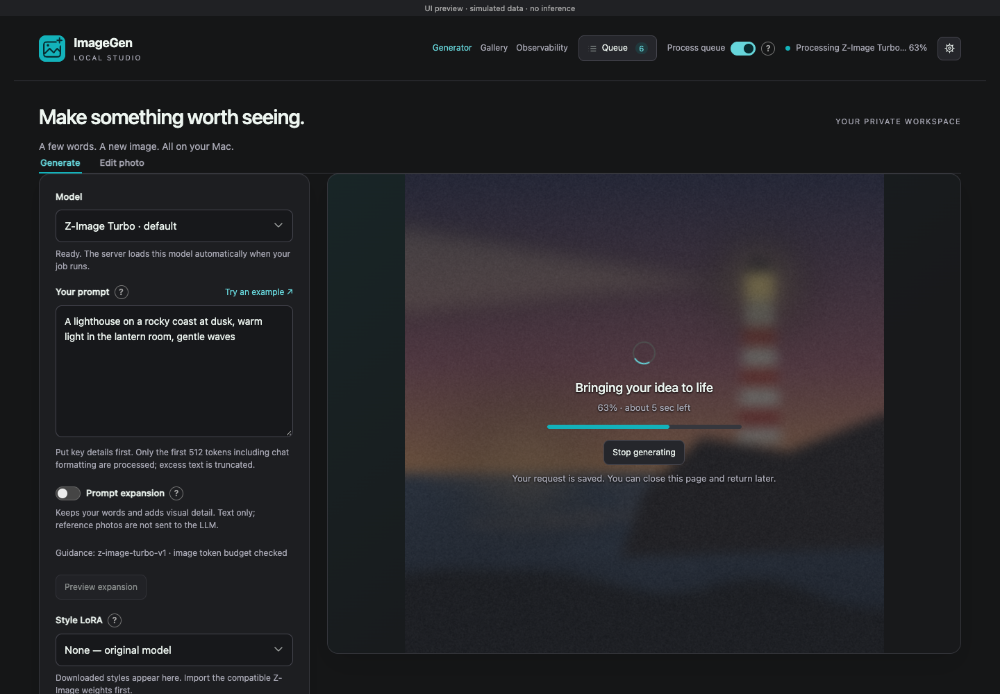
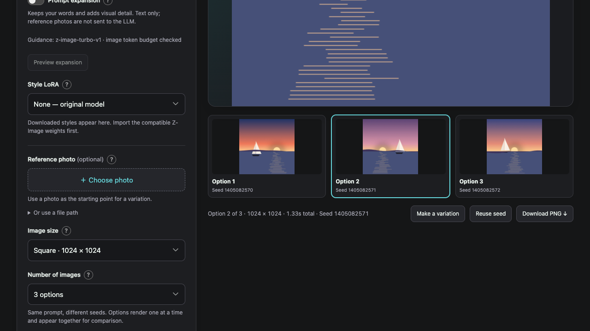
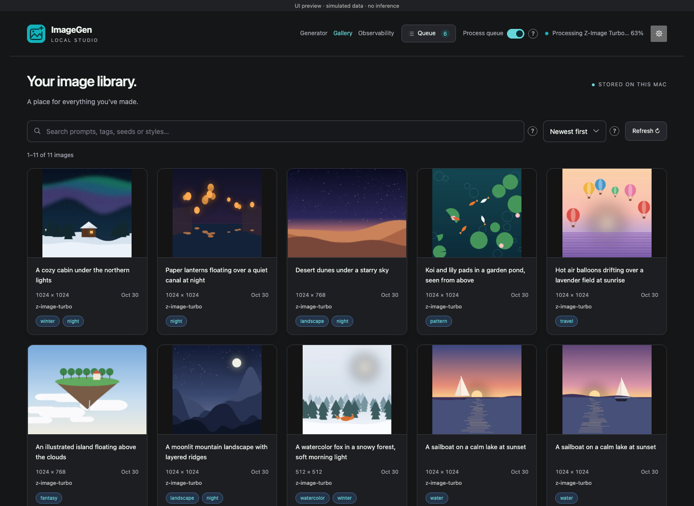
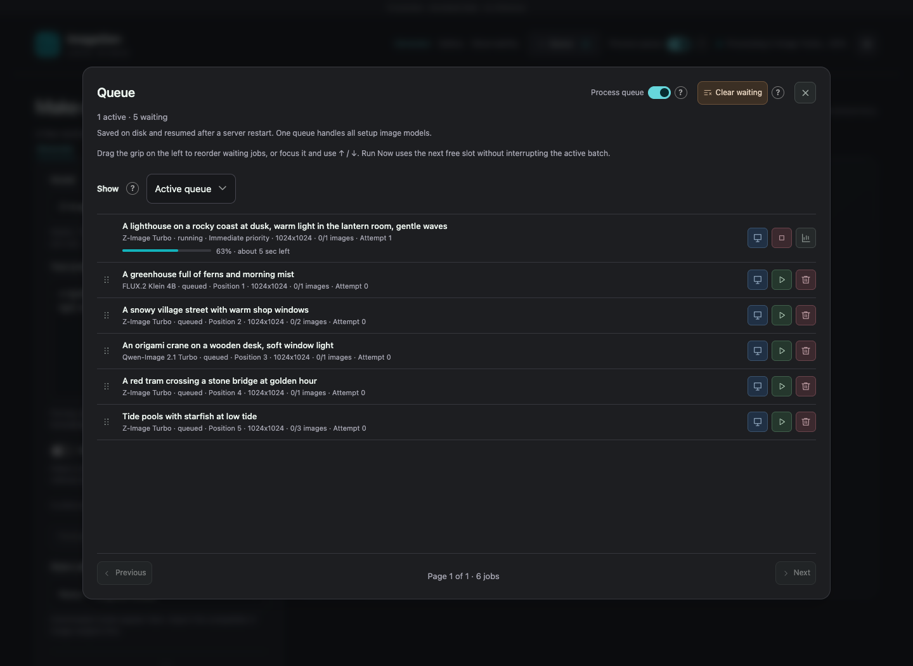

# ImageGen-Service

**A local image generation studio and API for Apple Silicon Macs.** Turn a description or reference photo into images, explore several options, and keep the results in a searchable gallery. After the initial downloads, image generation and prompt expansion run on your Mac without a cloud API.

The project brings **Z-Image Turbo**, **Chroma1-HD**, **Chroma1-Flash**, **FLUX.2 Klein 4B/9B** and **Qwen-Image 2.1 Turbo** into one app. They share a webpage, API and saved-image library; choose a setup model for each image request. A small local language model helps develop descriptions and explore compositions, while a persistent queue lets people and agents submit work whenever they need it.

Use the webpage for hands-on experimentation, or call the API from scripts and other tools. You can leave the lightweight queue running all day and start the image generator only when you want to use your Mac's compute.



For installation and a guided walkthrough of both interfaces, follow **[QUICKSTART.md](QUICKSTART.md)**. Run `make setup` successfully for at least one model before `make serve`; serving fails with setup instructions if the environment or all models are missing/incomplete.

## Techniques for better images

The service combines prompt development, creative alternatives and reference-based iteration. Each control is optional, so you can compare results and decide what helps your particular image.

### Develop the description while preserving the original

A local **Qwen3.5-2B model with 4-bit weights** can expand a short description with concrete details about light, palette, atmosphere, materials and composition. Your original text is kept verbatim, with added detail after it. The LLM is instructed to preserve your subjects, counts, actions, colors, viewpoint, quoted text and exclusions.

The expansion is guided by the requested medium and aesthetic. A watercolor prompt can gain translucent washes and soft edge variation; a cel-animation prompt can gain clean ink contours, flat color shapes and limited shadow tones. The goal is to develop the look you asked for through visible rendering choices.

Guidance also follows the selected image model. For Z-Image, expansions are checked against its actual tokenizer budget before rendering. You can preview the expanded description, edit and adopt it, or turn expansion off. Original and expanded prompts are saved with the image so you can see what was used. The expander reads text only; it does not inspect reference photos.

### Explore multiple options

Request **1–5 images** from the same description and compare them together. Each option uses a different seed. With **Different compositions with LLM** enabled, each also receives its own expanded prompt, exploring open choices such as a wide environmental view, closer framing, diagonal flow or layered depth.

The LLM is instructed to keep framing and other details you've explicitly specified, and explore choices you've left open. This gives you another way to seek variety when seed changes produce similar layouts, although tightly constrained prompts or strongly preserved references can still yield similar images.



### Guide the result with a reference or style adapter

A reference photo provides a visual starting point. **FLUX.2 Klein and Qwen-Image 2.1 Turbo** follow editing instructions such as “change the jacket to green.” With **Z-Image and Chroma**, the photo instead guides a variation, and **Keep the original** controls how much is preserved. The service keeps the photo's aspect ratio and lets you use generated images as the next reference. Use the dedicated **Edit photo** view to describe a change, specify what should stay the same, and optionally refine the instruction with a preservation-focused text LLM. With **Qwen**, drag a rectangle on the source preview to switch automatically to a selected-area edit; the service copies pixels outside the mask from the resized source. Klein supports whole-photo edits. Whole-photo editing does not guarantee exact identity or unchanged pixels.

Optional **LoRAs** are small adapters that influence the model's learned appearance or style. Choose a compatible installed adapter and adjust its strength; configured trigger words are inserted automatically. Normal setup downloads no adapters. **Realism for Z-Image Turbo** is the only bundled optional preset; see [adapter setup](docs/setup.md#optional-adapters).

### Make iteration easier to compare and repeat

Every image is saved with its prompt, expansion when used, seed, model, dimensions, steps and reference/adapter settings. Reuse a seed to compare setting changes, reuse a description, or make a variation from the result you like best. Saved settings give you a record of the choices behind each result.

The effect of prompt expansion and composition planning depends on the scene and model. Preview and compare results to decide which choices work best. The [prompt-expansion design and evidence](docs/prompt-expansion.md) explains the research, implementation choices and limits of the local evaluation.

## Generate or edit a photo

**Generate** offers every setup model, including Klein and Qwen, for text-to-image generation with an optional reference. **Edit photo** offers Klein 4B/9B and Qwen Turbo, requires an existing photo, and treats your prompt as an edit instruction. Each tab keeps its own prompt, model, settings, reference photo, area selection, expansion preview and image results while the page is open. Switching tabs restores that tab's work; a job finishing in the background updates only its own tab. To carry an image into another workflow, use **Edit image** or the gallery's reuse actions explicitly.

Edit uses one preview box: empty before upload, a centered source photo after upload at the same display scale as generated images, and the edited result after completion. On the first visit, choose an editing model; later visits restore your selection. Reference resolution defaults to **Auto**: it detects the oriented photo dimensions, keeps the original resolution without upscaling, and caps large photos at a 2048px long edge. You can choose a different long edge when needed. Editing uses the model's distilled step count, and alternate attempts at the same edit rather than new compositions. Drafts and uploads held by the webpage are not saved across a page reload; accepted jobs and their generated files remain saved.

The editing refiner clarifies the requested change and preservation requirements; it cannot see the photo and does not use the generation scene-expansion policy. Source-photo preview and Qwen area selection are available for uploaded files and gallery images. The API supports `POST /v1/images/edits` or asynchronous `POST /v1/jobs` with `task:"edit"`. Selected-area edits use `mask_image` on both the generator API and the independent queue API; see the [masked request examples](docs/api.md#selected-area-qwen-edits).

Choose a setup model for each request in the webpage. The generator switches automatically when that job reaches the front of the queue, after finishing the current batch. Only one image backend is active at a time; switching may add loading time. Consecutive Z-Image jobs reuse its resident model, while Chroma/Klein/Qwen retain their per-image low-memory runtime behavior.

## Choose a model

| Model ID | Checkpoint | Default steps | Reference workflow |
| --- | --- | ---: | --- |
| `z-image-turbo` | MLX 4-bit | 9 | Photo variations |
| `chroma1-hd` | GGUF Q4_K_M | 40 | Photo variations |
| `chroma1-flash` | GGUF Q4_K_M | 8 | Photo variations |
| `flux2-klein-4b` | MLX 8-bit | 4 | Instruction editing |
| `flux2-klein-9b` | MLX 4-bit | 4 | Instruction editing |
| `qwen-image-2.1-turbo` | MLX 4-bit, including vision encoder | 8 | Whole-photo/masked editing and RGBA output |

Add a model with `make setup MODEL=<model-id>`, then choose it in the webpage or an API request. `make serve MODEL=<model-id>` chooses the default for omitted request models. The interactive setup list marks models whose local assets are ready with `[SETUP COMPLETE]`. Setup downloads weights; serving uses local assets only. Start Qwen Turbo around 1024px for detail; peak memory depends on the reference and output size. These additions have fake-backend coverage; real performance on a 24GB Mac still needs measurement.

Klein 4B uses Apache 2.0. Commercial model use of [Klein 9B](https://huggingface.co/black-forest-labs/FLUX.2-klein-9B) and [Qwen Turbo](https://huggingface.co/Qwen/Qwen-Image-2.1-Turbo/blob/main/LICENSE) requires the respective owner's separate license. The service shows their model-specific notices when each backend loads and in the webpage/API.

## Keep a searchable image library

The gallery brings together results from all supported models, including images saved to custom output folders. Search by prompt or tags, sort and browse pages, and open an image to see its settings, download it, edit its tags or use it as a starting point for another generation. Choose **Edit photo** to open the selected image directly in the Edit preview, even when a different model created it. The action is available whenever a setup model supports editing. Choose an editor if prompted, describe the change and submit; your original file stays unchanged. **Make a variation** and **Reuse settings** remain separate actions.



PNG images and JSON generation records are saved automatically in `<storage folder>/<model>/images`, unless you choose another output location. Tag edits are stored separately so the original image and generation record remain intact.

## Queue work around your schedule

The app has two services that share a persistent SQLite queue:

| Service | What it does |
| --- | --- |
| **Generator and webpage**, [localhost:5742](http://localhost:5742/) | Runs one image backend at a time and the optional prompt expander, serves the UI/gallery, and processes the shared queue across all setup models. |
| **Lightweight queue API**, [localhost:55302/docs](http://localhost:55302/docs) | Accepts and manages jobs while the generator is off, without loading image models or the LLM. |

Ordinary jobs run in order. The webpage defaults to **Generate immediately**, which puts your request in the next free slot ahead of ordinary queued work. Active batches finish first. You can pause ordinary work, cancel waiting jobs, clear the waiting list and retry failed jobs.



Jobs survive restarts. The generator accesses SQLite directly, so the webpage and generation continue if the standalone queue API stops. Jobs retain their requested model. If its files become unavailable after admission, it stays waiting with an explanation while other eligible jobs continue. New requests for models that need setup are rejected; run setup first.

The header’s **Queue** button opens a modal with the active/waiting count, pause/clear controls and saved history. Compact controls pair icons with labels, using muted blue for **Monitor**, green for **Run Now**, and red for **Remove**, matching VoiceGen. Drag waiting jobs into a different order or use **Run Now** to put one next, after the active batch finishes. Run Now also works while ordinary work is paused. Saved order survives restarts, and both APIs expose the same controls.

## Built for local hardware and storage

Quantized model weights and Apple's Metal GPU help make local inference practical. Image options render sequentially, and the prompt-expansion process releases its memory before image rendering. FLUX.2 Klein and Qwen use pre-quantized MLX checkpoints and low-memory child processes, releasing their weights after each image. Resolution, image count and model choice affect memory use and generation time; Chroma can be substantially slower on this Mac.

Model downloads and generated media can live inside the project or on an external SSD. Setup remembers the location and creates links when needed. The source code, Python environment and SQLite queue database stay in the project. Back up both your model/media store and the project's `state/` folder to preserve images, tags and waiting work. Downloaded weights and personal media are excluded from Git.

The generator, gallery and queue screenshots use demonstration data and a simulated backend; their timings are not benchmarks. The multiple-options screenshot shows a real two-image Z-Image test.

## Resource history

Open **Observability** in the webpage header to see CPU, memory and GPU line graphs over **5m, 30m, 1h, 6h, 24h, 3 days or 7 days**. Filter by model or open a measured job for its full execution timeline and shorter windows. The queue’s **Metrics** links open the matching job. Its **Generation logs** panel shows available runtime messages, stages and errors, with live updates and separate attempt logs. Older jobs may only have native output logs or no attributable logs.

CPU and RAM include the generator and its child processes, including prompt expansion and native model tools. GPU readings cover the whole device, including other apps; GPU memory shares the Mac’s RAM. Sampling runs while the generator is on, with stopped periods shown as gaps. Eight days of raw history and durable job summaries live in project-local SQLite, independently of the queue. See the [API reference](docs/api.md#observability) for the exact measurement scopes.

## Quick start

Requires an **Apple Silicon Mac**, Git and Make. Setup reuses compatible Python already on your Mac, or downloads it into the project when needed; you do not need to install a specific Python version first. Your system Python and shell settings stay unchanged. See the [quick-start guide](QUICKSTART.md#1-check-the-prerequisites) for prerequisites and Chroma runtime compatibility.

```sh
git clone https://github.com/ashwinmahesh/ImageGen-Service.git
cd ImageGen-Service
make setup
make serve
```

During first setup, Enter chooses Z-Image Turbo and project-local storage; you can select another model or an external folder. Serving asks for a default from installed models; all setup models can process jobs. The saved default is shared by both APIs and used when a request omits its model. The menu labels Klein with `(edits enabled)` and Qwen with `(edit selected area enabled)`, and enables prompt expansion by default. Open **[http://localhost:5742](http://localhost:5742/)** once startup finishes.

Setup is safe to rerun, including for a model marked `[SETUP COMPLETE]`: unchanged weights need no redownload, and missing or changed pinned files are updated in place. Dependencies and shared assets are still checked. Choose `q` at the setup model menu or press Ctrl+C during setup to cancel cleanly; downloaded files are kept for your next attempt.

`make serve` also starts the background queue API if needed. Ctrl-C stops the generator after its active batch finishes; `make stop-queue` stops the queue API separately. Use `make serve NO_LLM=1` to disable prompt expansion or `make serve NO_LORAS=1` to disable adapters.

## Documentation

- **[QUICKSTART.md](QUICKSTART.md)**: step-by-step setup, UI and API walkthroughs, settings and shutdown.
- **[Complete API reference](docs/api.md)**: every endpoint on both services, request/response fields, examples, errors, queue management and media downloads.
- **[Setup reference](docs/setup.md)**: model sources, storage choices, startup options and runtime details.
- **[Prompt-expansion design](docs/prompt-expansion.md)**: techniques, research and evaluation limits.

While running, the generator publishes [interactive API docs](http://localhost:5742/docs). The standalone queue API has [its own docs](http://localhost:55302/docs) and a request envelope for submitting work while the generator is stopped. The [quick-start API walkthrough](QUICKSTART.md#5-generate-through-the-api) explains the difference.

For code changes, read [AGENTS.md](AGENTS.md). An AI tool operating the service can use [the service skill](skill/image-model-server/SKILL.md).

## If something goes wrong

- **Interrupted download:** rerun `make setup MODEL=<model-id>` to reuse or resume it.
- **External drive missing:** reconnect it; the generator won't silently download to another location.
- **Missing prompt LLM:** run `make download-llm`, or start with `make serve NO_LLM=1`.
- **Port conflict:** use `make serve PORT=5733` and open that port in the browser.
- **Slow generation or memory pressure:** try smaller images or fewer options and close other GPU-heavy apps.

`make health` checks a running generator. `make test` uses simulated downloads and generation; `make smoke` generates a real test image on a running server. Further details are in the [setup reference](docs/setup.md#verification-and-troubleshooting).
